# Arquitetura de classes — guia explicado

Este documento é um **guia de leitura do código**: o que cada classe é, quais métodos ela
oferece, o que ela representa dentro do projeto e como ela conversa com as outras. A
linguagem é deliberadamente simples e com analogias, para servir de material de estudo.

Os diagramas estão neste próprio arquivo, em Mermaid — que o GitHub renderiza. É a única
versão mantida do documento: o `.pdf` e o `.html` exportados antes foram descartados para
não versionar três cópias do mesmo conteúdo, com duas delas envelhecendo a cada mudança de
classe.

---

## Índice

- [1. Como ler este documento](#1-como-ler-este-documento)
- [2. O projeto em uma página](#2-o-projeto-em-uma-página)
- [3. O mapa: 4 pacotes, 11 classes](#3-o-mapa-4-pacotes-11-classes)
- [4. Diagrama de classes](#4-diagrama-de-classes)
- [5. As classes, uma a uma](#5-as-classes-uma-a-uma)
  - [5.1 `support` — o motor](#51-support--o-motor)
  - [5.2 `components` — os tradutores de tela](#52-components--os-tradutores-de-tela)
  - [5.3 `data` — a massa de teste](#53-data--a-massa-de-teste)
  - [5.4 `tests` — quem decide o que é certo](#54-tests--quem-decide-o-que-é-certo)
- [6. Linha do tempo de um teste](#6-linha-do-tempo-de-um-teste)
- [7. Os relacionamentos, explicados](#7-os-relacionamentos-explicados)
- [8. Conceitos de projeto usados aqui](#8-conceitos-de-projeto-usados-aqui)
- [9. Glossário](#9-glossário)

---

## 1. Como ler este documento

Três avisos que evitam confusão desde o começo:

**Não existe código de produção aqui.** Tudo vive em `src/test/java`. O projeto não é um
sistema; é uma **suíte de testes automatizados** que abre um navegador de verdade e usa o
site [PlayLab](https://playwrightlab.github.io/) como se fosse uma pessoa. O "produto" que
este repositório entrega é a *confiança* de que aquele site funciona — mais os defeitos
encontrados.

**Classe não é a mesma coisa que tela.** Quem vem de um curso de POO espera `Cliente`,
`Pedido`, `Produto`. Aqui as classes modelam **papéis de um teste**: quem abre o navegador,
quem sabe onde ficam os botões, quem inventa os dados, quem julga o resultado.

**O vocabulário é misto, de propósito.** O código usa termos ingleses do framework
(`Page`, `Locator`, `fill`, `submit`) junto com nomes portugueses do domínio
(`placeholderInicial`, `valido`, `sortBy(Column coluna)`). Isso é intencional: o termo do
framework fica reconhecível para quem lê a documentação do Playwright, e o termo do
negócio fica legível para quem lê o teste.

---

## 2. O projeto em uma página

| | |
|---|---|
| **O que é** | Suíte de testes automatizados de front-end web |
| **Alvo** | PlayLab — Playwright Practice Arena (site público e estático) |
| **Linguagem** | Java 21 (LTS) |
| **Ferramenta de navegador** | Playwright for Java 1.63.0 |
| **Executor de testes** | JUnit Jupiter 6.1.3 |
| **Asserções** | `PlaywrightAssertions` (com *retry*) + AssertJ (para listas em memória) |
| **Acessibilidade** | axe-core 4.14.0 |
| **Relatório** | Allure 2.35.5 |
| **Tamanho** | 11 classes de código + 5 classes de teste → **11 cenários** |

A ideia central da arquitetura cabe em uma frase:

> **O teste decide o que é certo. O componente sabe onde as coisas estão. O suporte abre o
> navegador. Ninguém faz o trabalho do outro.**

Essa separação é o que você vai reconhecer em cada classe daqui para frente.

---

## 3. O mapa: 4 pacotes, 11 classes

```
src/test/java/com/samuellima/playlab/
│
├── support/        ← o motor: liga e desliga o navegador, lê configuração, guarda evidência
│   ├── TestConfig.java
│   ├── Viewport.java
│   ├── BrowserFactory.java
│   ├── Layout.java
│   └── PlaywrightExtension.java
│
├── components/     ← os tradutores: "campo de e-mail" → seletor real na página
│   ├── RegistrationFormComponent.java
│   ├── UserTableComponent.java
│   └── DelayedDropdownComponent.java
│
├── data/           ← a massa: os dados que o teste digita no formulário
│   ├── RegistrationData.java
│   └── RegistrationDataFactory.java
│
└── tests/          ← os juízes: os 10 cenários, com as asserções
    ├── users/UserTableTest.java            (5 cenários)
    ├── forms/RegistrationFormTest.java     (2 cenários)
    ├── dynamic/DelayedDropdownTest.java    (1 cenário)
    ├── accessibility/AccessibilityTest.java (1 cenário)
    └── responsive/ResponsiveLayoutTest.java (1 cenário)
```

**A regra de ouro das dependências é a direção única:**

```
tests  ──→  components  ──→  data
   │             │
   └──→ support  └──────────→ Playwright (Page, Locator)
```

`tests` conhece todo mundo. `components` conhece `data` e o Playwright, mas **nunca** um
teste. `support` não conhece nem componente nem teste. Nenhuma seta volta.

Por que isso importa: se `components` soubesse de `tests`, mudar uma asserção poderia
quebrar o componente, e mudar o componente poderia quebrar um teste que você nem abriu.
Com a seta em uma direção só, você sempre sabe de antemão o alcance de uma mudança.

---

## 4. Diagrama de classes

O diagrama abaixo é renderizado pelo GitHub. A versão desenhada com mais detalhe e
anotações didáticas está no PDF.

```mermaid
classDiagram
    direction TB

    class UserTableTest {
        <<teste>>
        +tabelaCarregaComEstruturaEDadosEsperados(Page)
        +pesquisaLocalizaUsuarioExistente(Page)
        +pesquisaSemCorrespondenciaEsvaziaTabela(Page)
        +ordenacaoPorIdEhNumericaEAlterna(Page)
        +navegacaoEntrePaginasPercorreTodosOsRegistros(Page)
    }
    class RegistrationFormTest {
        <<teste>>
        +cadastroComDadosValidosConfirmaSucesso(Page)
        +emailInvalidoBloqueiaEnvioEAcusaErroNoCampoCorreto(Page)
    }
    class DelayedDropdownTest {
        <<teste>>
        +dropdownAssincronoCarregaEPermiteSelecao(Page)
    }
    class AccessibilityTest {
        <<teste>>
        +analiseAutomatizadaDoFormularioNaoAcusaViolacaoNova(Page)
    }

    class UserTableComponent {
        <<component object>>
        -Locator root
        -Locator rows
        -Locator searchField
        -Locator summary
        -Locator pagination
        +search(String) UserTableComponent
        +sortBy(Column) UserTableComponent
        +goToPage(int) UserTableComponent
        +goToNextPage() UserTableComponent
        +deleteUser(int) UserTableComponent
        +rows() Locator
        +summary() Locator
        +columnHeader(Column) Locator
        +columnCells(Column) Locator
        +rowForUserId(int) Locator
        +deleteButton(int) Locator
        -columnIndex(Column) int
    }
    class Column {
        <<enumeration>>
        ID
        NAME
        EMAIL
        ROLE
        STATUS
        ACTIONS
        +testId() String
        +sortable() boolean
    }
    class RegistrationFormComponent {
        <<component object>>
        -Locator fullName
        -Locator email
        -Locator password
        -Locator submitButton
        +fill(RegistrationData) RegistrationFormComponent
        +fillEmail(String) RegistrationFormComponent
        +submit() RegistrationFormComponent
        +successMessage() Locator
        +emailError() Locator
        +passwordError() Locator
        +termsError() Locator
    }
    class DelayedDropdownComponent {
        <<component object>>
        -Locator loadButton
        -Locator select
        -Locator loader
        +load() DelayedDropdownComponent
        +selectByLabel(String) DelayedDropdownComponent
        +select() Locator
        +loader() Locator
        +options() Locator
        +selectableOptions() Locator
        +result() Locator
    }

    class RegistrationData {
        <<record>>
        +String fullName
        +String email
        +String password
        +String phone
        +String bio
        +String countryCode
    }
    class RegistrationDataFactory {
        <<factory>>
        -AtomicInteger SEQUENCIA
        +valido() RegistrationData
    }

    class PlaywrightExtension {
        <<JUnit Extension>>
        +beforeEach(ExtensionContext)
        +afterTestExecution(ExtensionContext)
        +afterEach(ExtensionContext)
        +supportsParameter(..) boolean
        +resolveParameter(..) Object
        -attachScreenshot(..)
        -attachTrace(..)
        -attachPageLog(..)
    }
    class Session {
        <<record>>
        +Playwright playwright
        +Browser browser
        +BrowserContext browserContext
        +Page page
        +List~String~ pageLog
    }
    class TestConfig {
        <<utilitário estático>>
        +baseUrl() String
        +browser() String
        +headless() boolean
        +viewport() Viewport
        +actionTimeoutMs() double
        +assertionTimeoutMs() double
    }
    class Viewport {
        <<record>>
        +String profile
        +int width
        +int height
    }
    class BrowserFactory {
        <<factory estática>>
        +launch(Playwright, String, boolean) Browser
    }
    class Layout {
        <<utilitário estático>>
        +documentScrollWidth(Page) int
        +viewportWidth(Page) int
        +overflowX(Locator) String
    }

    UserTableTest ..> PlaywrightExtension : @ExtendWith
    RegistrationFormTest ..> PlaywrightExtension : @ExtendWith
    DelayedDropdownTest ..> PlaywrightExtension : @ExtendWith
    AccessibilityTest ..> PlaywrightExtension : @ExtendWith
    ResponsiveLayoutTest ..> PlaywrightExtension : @ExtendWith

    UserTableTest ..> UserTableComponent : instancia
    RegistrationFormTest ..> RegistrationFormComponent : instancia
    RegistrationFormTest ..> RegistrationDataFactory : pede massa
    DelayedDropdownTest ..> DelayedDropdownComponent : instancia
    ResponsiveLayoutTest ..> UserTableComponent : instancia
    ResponsiveLayoutTest ..> Layout : mede

    UserTableComponent *-- Column : enum interno
    RegistrationFormComponent ..> RegistrationData : consome
    RegistrationDataFactory ..> RegistrationData : cria

    PlaywrightExtension *-- Session : record interno
    PlaywrightExtension ..> TestConfig : lê
    PlaywrightExtension ..> BrowserFactory : usa
    TestConfig ..> Viewport : cria
```



---

## 5. As classes, uma a uma

### 5.1 `support` — o motor

Este pacote não sabe nada sobre tabela, formulário ou dropdown. Ele só sabe **abrir um
navegador do jeito certo, entregá-lo pronto ao teste e guardar as provas quando algo dá
errado**. É a parte que mais se parece com infraestrutura.

---

#### `TestConfig`

> **Em uma frase:** o único lugar do projeto que sabe ler configuração.

**O que representa.** O painel de controle da suíte. Qual navegador usar, em qual URL,
visível ou invisível, em qual resolução, com qual tempo máximo de espera.

**Por que existe.** Sem ela, cada classe chamaria `System.getProperty("browser")` por
conta própria, cada uma com um valor padrão diferente, e descobrir "em qual resolução esse
teste rodou?" exigiria caçar por todo o código. Centralizar transforma dez respostas
possíveis em uma só.

**O detalhe mais instrutivo: a ordem de precedência.** O método privado `get(chave, padrão)`
procura o valor em quatro lugares, **e para no primeiro que encontrar**:

| Prioridade | Origem | Exemplo |
|---|---|---|
| 1ª (ganha) | *System property* da linha de comando | `mvn test -Dbrowser=firefox` |
| 2ª | Variável de ambiente (ponto vira *underscore*, tudo maiúsculo) | `BROWSER=firefox` |
| 3ª | Arquivo `src/test/resources/config.properties` | `browser=chromium` |
| 4ª (último recurso) | Valor padrão escrito no código | `"chromium"` |

Isso resolve um problema real: a *pipeline* precisa trocar o navegador sem editar arquivo
nenhum (prioridade 1), e a sua máquina precisa continuar funcionando com o padrão
(prioridade 3) sem você digitar nada.

**Métodos**

| Assinatura | O que faz |
|---|---|
| `static String baseUrl()` | URL do site sob teste. Padrão: `https://playwrightlab.github.io/` |
| `static String browser()` | `chromium`, `firefox` ou `webkit` |
| `static boolean headless()` | `true` = navegador invisível (padrão, mais rápido); `false` = você vê a tela |
| `static Viewport viewport()` | Monta o objeto de resolução a partir do perfil ativo (`desktop` / `mobile`) |
| `static double actionTimeoutMs()` | Teto de espera de cliques e preenchimentos (10 s) |
| `static double assertionTimeoutMs()` | Teto de espera das asserções (10 s) |
| `private static int getInt(k, padrão)` | Converte texto em número e **falha com mensagem clara** se vier lixo |
| `private static String get(k, padrão)` | Implementa a precedência de 4 níveis descrita acima |
| `private static Properties load()` | Lê o `config.properties` uma vez, na carga da classe |

**Dois detalhes de Java que valem reparar.** A classe é `final` e tem **construtor
privado** (`private TestConfig() {}`): isso significa "não me instancie, eu não tenho
estado próprio, me use pelos métodos estáticos". E `viewport()` **falha de propósito** se
você pedir um perfil que não existe no `.properties`, em vez de devolver silenciosamente
uma resolução inventada:

```java
throw new IllegalStateException(
        "Perfil de viewport '" + profile + "' nao tem viewport." + profile
                + ".width/.height definidos no config.properties");
```

Um teste que roda na resolução errada e passa é pior que um teste que não roda.

---

#### `Viewport`

> **Em uma frase:** a resolução da janela, com o nome do perfil colado nela.

**O que representa.** O tamanho da tela emulada: `desktop (1280x720)` ou
`mobile (390x844)`.

**Por que existe como classe.** Poderia ser só dois `int` passados adiante. O problema é
que `(390, 844)` não diz nada no relatório, e `(844, 390)` trocado de ordem compila
igual. Carregando o **perfil** junto, a informação fica rastreável: o nome aparece no
Allure e no nome da pasta de evidência, e você sabe que aquele *screenshot* veio da
execução *mobile*.

**É um `record`.** Em Java, `record` é uma classe de dados imutável onde o compilador
escreve para você o construtor, os acessadores, `equals`, `hashCode` e `toString`. A
declaração inteira é uma linha:

```java
public record Viewport(String profile, int width, int height) { ... }
```

**Métodos**

| Assinatura | O que faz |
|---|---|
| `profile()`, `width()`, `height()` | Acessadores gerados pelo `record` |
| `String toString()` | Sobrescrito para sair legível: `desktop (1280x720)` |

**Uma limitação registrada no próprio código.** O projeto emula **resolução**, não
**dispositivo**: não liga `isMobile` nem `hasTouch` do Playwright, porque essas opções só
funcionam no Chromium e quebrariam a execução no Firefox. Consequência honesta: a execução
em 390x844 valida *layout* e alcance dos controles, **não** comportamento de toque. Saber
o que um teste **não** prova vale tanto quanto saber o que ele prova.

---

#### `BrowserFactory`

> **Em uma frase:** traduz o texto `"firefox"` no objeto de navegador do Playwright.

**O que representa.** Um tradutor minúsculo, de um método só.

**Por que existe.** Duas razões, e a segunda é a boa.

A primeira: isolar o `switch` que mapeia nome → engine.

```java
BrowserType type = switch (engine.toLowerCase()) {
    case "chromium" -> playwright.chromium();
    case "firefox"  -> playwright.firefox();
    case "webkit"   -> playwright.webkit();
    default -> throw new IllegalArgumentException("Navegador nao suportado: ...");
};
```

A segunda: **transformar um erro ilegível em uma instrução.** Se o binário do navegador não
estiver instalado na máquina, o Playwright lança uma exceção de driver que não diz o que
fazer. A classe captura e devolve o comando exato:

```java
throw new IllegalStateException(
        "Nao foi possivel abrir o navegador '" + engine + "'. Se ele nao estiver"
                + " instalado, rode:" + System.lineSeparator()
                + "  mvn exec:java -D exec.args=\"install " + engine + "\"" ...);
```

Isso é uma decisão de **experiência de quem mantém a suíte**. A mensagem de falha é parte
do produto.

---

#### `Layout`

> **Em uma frase:** lê do navegador as três medidas de que o teste de responsividade precisa.

**O que representa.** Um utilitário estático de três métodos, cada um uma linha de
`evaluate`.

**Por que existe.** Para que o cenário de layout assevere **números** sem carregar cálculo
de CSS dentro dele. Sem esta classe, `RSP-04` viraria um teste com JavaScript embutido no
meio da asserção — e a regra da suíte é que o teste declara intenção, não mede geometria.

| Assinatura | O que devolve |
|---|---|
| `int documentScrollWidth(Page)` | largura total do documento, incluindo o que transborda da janela |
| `int viewportWidth(Page)` | largura visível da janela |
| `String overflowX(Locator)` | o valor **efetivo** de `overflow-x` do elemento, como o navegador o calcula |

O terceiro é o mais interessante: lê `getComputedStyle`, e não o atributo de estilo. A
diferença importa, porque a regra que contém o transbordo da tabela vem de folha de estilo,
e não de `style` inline — ler o atributo devolveria vazio e a asserção passaria sem provar
nada.

**Métodos**

| Assinatura | O que faz |
|---|---|
| `static Browser launch(Playwright, String engine, boolean headless)` | Abre o navegador pedido, ou falha explicando como instalá-lo |

---

#### `PlaywrightExtension`

> **Em uma frase:** a classe mais importante do projeto — o ciclo de vida de cada teste.

**O que representa.** O maquinista. Antes de cada cenário ela abre navegador, contexto e
página, navega até o site e entrega tudo pronto. Depois de cada cenário ela coleta provas
(se falhou) e fecha tudo (sempre).

**O que é uma "extensão do JUnit".** É o jeito do JUnit de dizer "rode esse código em
volta dos meus testes". A classe implementa quatro interfaces, e cada uma é um gancho em um
momento diferente:

| Interface implementada | Momento | O que a classe faz nele |
|---|---|---|
| `BeforeEachCallback` | antes de cada teste | abre Playwright → navegador → contexto → página, navega, liga o *trace* |
| `ParameterResolver` | ao montar a chamada do teste | entrega a `Page` como parâmetro do método |
| `AfterTestExecutionCallback` | logo após o corpo do teste, **página ainda viva** | se falhou: *screenshot*, *trace*, log de console |
| `AfterEachCallback` | no fim | fecha os recursos na ordem inversa da criação |

**O detalhe mais fácil de errar na vida real.** `afterTestExecution` e `afterEach` parecem
a mesma coisa, mas não são. O *screenshot* **tem** que ser tirado no primeiro: no segundo, a
página já pode ter sido fechada. O próprio código registra isso:

> *"Captura de evidência. Roda **antes** dos `@AfterEach` e antes do Allure encerrar o caso
> de teste, com a página ainda viva. Um `TestWatcher` rodaria tarde demais."*

**Três decisões que valem estudar**

1. **Extensão em vez de herança.** Um teste em Java só pode ter **uma** superclasse. Se
   `UserTableTest extends BaseTest`, esse slot único já foi gasto, e o estado (`page`) chega
   escondido, por campo herdado. Com extensão, o teste **declara** o que quer:

   ```java
   void pesquisaLocalizaUsuarioExistente(Page page) { ... }
   ```

   Nada de mágica: a `Page` está ali na assinatura, visível. Esse é o modelo de *fixture*
   que o Playwright entrega de fábrica em TypeScript e que o *binding* Java não traz —
   `PlaywrightExtension` é exatamente a reconstrução dele.

2. **Um `BrowserContext` novo por teste, e um `Browser` para a execução inteira.** O
   contexto é como uma janela anônima: cookies, *storage* e alterações de DOM morrem com
   ele. Como o PlayLab é estático e não tem API para semear ou limpar dados, **o contexto
   novo é o reset**. É daí que vem a independência total: nenhum cenário depende da ordem de
   execução nem do resultado de outro. O **navegador**, ao contrário, é aberto uma única vez:
   ele não acrescenta isolamento nenhum, e abrir a engine por cenário custava ~8 s na suíte.

3. **O estado vive no `Store` do JUnit, nos dois escopos, não em `ThreadLocal`.** O contexto
   e a página ficam no `Store` por teste; `Playwright` e `Browser` ficam no `Store` **raiz**,
   num `record Engine` que implementa `Store.CloseableResource` e `AutoCloseable` — o próprio
   JUnit o fecha no fim da execução. Usar o `Store` é reaproveitar um escopo que o
   *framework* garante, em vez de reimplementar um à mão e correr o risco de vazar memória se
   a remoção falhar.

**Métodos**

| Assinatura | Papel |
|---|---|
| `void beforeEach(ExtensionContext)` | Monta o que é por teste: contexto (com `baseURL`, *viewport*, *timeouts*), *trace*, página, escutas de console, navegação, registro no Allure. O navegador vem de `browser(...)` |
| `void afterTestExecution(ExtensionContext)` | **Passou:** descarta o *trace*. **Falhou:** salva *screenshot*, *trace* e log em `target/evidence/<Classe>/<metodo>/` e anexa ao Allure |
| `void afterEach(ExtensionContext)` | Fecha página → contexto, cada um com `closeQuietly`. O navegador **não** é fechado aqui: ele dura a execução |
| `Browser browser(ExtensionContext, String)` | Devolve o navegador da execução, abrindo-o no primeiro teste que precisar. Chave por engine, no `Store` raiz |
| `boolean supportsParameter(..)` | Responde ao JUnit: "sim, eu sei preencher parâmetros do tipo `Page`" |
| `Object resolveParameter(..)` | Devolve a `Page` daquele teste |
| `private void attachScreenshot(..)` | PNG de página inteira |
| `private void attachTrace(..)` | `trace.zip` — gravação navegável em [trace.playwright.dev](https://trace.playwright.dev) |
| `private void attachPageLog(..)` | Mensagens de console e erros de JS da página |
| `private Session session(..)` | Busca a sessão no `Store` |
| `private static String sanitize(String)` | Troca caracteres proibidos em nome de arquivo por `_` |
| `private static void closeQuietly(AutoCloseable)` | Fecha sem deixar uma falha de *teardown* mascarar a falha real do teste |

**O `record Session` interno.** Cinco recursos que precisam ser fechados na ordem certa,
mantidos juntos num só objeto: `Playwright`, `Browser`, `BrowserContext`, `Page` e a lista
de log. Guardar os cinco soltos convidaria a esquecer um aberto.

**Uma linha que parece bobagem e não é.** A extensão desliga o *download* automático de
navegador antes de criar o Playwright:

```java
Playwright.create(new Playwright.CreateOptions()
        .setEnv(Map.of("PLAYWRIGHT_SKIP_BROWSER_DOWNLOAD", "1")));
```

Sem isso, numa máquina sem os binários o **primeiro teste** baixaria mais de 100 MB no meio
da execução: o teste fica lento sem explicação, o tempo de rede entra na duração do
relatório, e o progresso do *download* escreve no `stdout` do processo filho e corrompe o
canal do Surefire. A instalação virou passo próprio, documentado no README.

---

### 5.2 `components` — os tradutores de tela

Aqui mora o padrão central da arquitetura. Vale entendê-lo antes de ver as três classes.

#### O padrão: **Component Object**, não *Page Object*

O *Page Object* clássico é "uma classe por página". O PlayLab é **uma única página** com
dezenas de componentes independentes: formulário, tabela, *dropdown*, abas, modais... Uma
classe por página viraria um arquivo com centenas de `Locator` sem relação entre si —
impossível de manter e impossível de navegar.

O recorte adotado é **o componente**: o que está dentro do `table-card` é do
`UserTableComponent`, e nada mais.

#### A regra que define esse pacote: **o componente não assevera**

Nenhuma das três classes tem um único `assertThat`. Elas oferecem duas coisas:

- **ações** — `search("alice")`, `submit()`, `load()`;
- **`Locator`s** — `rows()`, `emailError()`, `loader()`.

Quem julga é o teste. E tem um motivo técnico forte para devolver `Locator` em vez de
`String`:

> Um `Locator` é uma **pergunta ainda não respondida** ("as linhas do corpo da tabela"),
> não a resposta. A asserção do Playwright reavalia essa pergunta no DOM várias vezes até a
> condição bater ou o tempo acabar. Se o componente devolvesse `String`, ele entregaria o
> **retrato de um instante** — e o teste de ordenação voltaria a depender de "ler a tabela
> depois que o JavaScript terminou", que é exatamente a origem de teste instável.

Essa é a diferença entre uma suíte que você confia e uma que você re-executa até passar.

#### Estratégia de seletores

Todos os três componentes endereçam elementos por `data-testid`, via
`page.getByTestId(...)` — nunca por classe CSS, texto visível ou posição. `data-testid` é
um atributo que existe **para** ser usado por teste: muda de propósito, não por acidente de
redesign.

---

#### `RegistrationFormComponent`

> **Em uma frase:** o formulário de cadastro visto de fora.

**O que representa.** Os 8 campos, os 2 botões, a mensagem de sucesso e os 4 campos de erro
da seção *Form Elements › Registration Form*.

**O detalhe que muda a forma de asseverar — e é a lição mais valiosa deste componente.**
Os `<span>` de erro desta aplicação estão **sempre no DOM e sempre visíveis**; o que muda é
o texto, que começa vazio. Ou seja:

```java
assertThat(formulario.emailError()).isVisible();   // passa mesmo SEM erro nenhum
assertThat(formulario.emailError()).hasText("Valid email is required");  // prova o comportamento
```

A primeira linha é a "asserção genérica que não comprova o comportamento" que todo desafio
de QA pede para evitar. O componente existe em parte para entregar o `Locator` certo e
deixar o teste asseverar **texto**.

Vale notar também que o formulário tem o atributo `novalidate`: o navegador não valida nada,
toda a regra é da aplicação. Isso é bom para o teste — as mensagens são elementos de DOM
normais, alcançáveis por `Locator`, e não balões nativos do navegador, que seriam
inacessíveis.

**Métodos — ações**

| Assinatura | O que faz |
|---|---|
| `fill(RegistrationData dados)` | Preenche nome, e-mail, senha, telefone, bio, país e marca os termos |
| `fillEmail(String valor)` | Sobrescreve só o e-mail — é o que viabiliza o cenário negativo |
| `submit()` | Clica em *Register* |
| `reset()` | Clica em *Reset* |

Todas devolvem `this`, o que permite escrever o teste como uma frase:

```java
formulario.fill(dados).fillEmail("email-invalido-sem-arroba").submit();
```

**Métodos — `Locator`s**

| Assinatura | Aponta para |
|---|---|
| `root()` | o `<form>` inteiro |
| `successMessage()` | a faixa verde de confirmação |
| `fullNameError()`, `emailError()`, `passwordError()`, `termsError()` | os quatro `<span>` de erro |

Repare que os erros são buscados **a partir do `root`** (`root.getByTestId("error-email")`),
não da página toda. Se amanhã o PlayLab tiver dois formulários, este componente continua
olhando só para o seu.

---

#### `UserTableComponent`

> **Em uma frase:** a tabela de usuários — o componente mais rico do projeto.

**O que representa.** A seção *Data Tables › User Management*: 15 usuários, 5 por página,
pesquisa, ordenação por coluna e paginação.

**O `enum Column` interno — e por que ele é mais que uma lista de nomes.**

```java
public enum Column {
    ID("sort-id", true),     NAME("sort-name", true),  EMAIL("sort-email", true),
    ROLE("col-role", false), STATUS("sort-status", true), ACTIONS("col-actions", false);
}
```

Cada constante carrega **duas informações**: o `data-testid` do `<th>` e se a coluna é
ordenável. E aí está o detalhe elegante: na aplicação, só as colunas ordenáveis recebem o
prefixo `sort-`; `ROLE` e `ACTIONS` usam `col-`. **A diferença de nome é o próprio
contrato**, e o `enum` o deixa explícito.

A consequência prática aparece em `sortBy`:

```java
if (!coluna.sortable()) {
    throw new IllegalArgumentException("A coluna " + coluna + " nao e ordenavel na aplicacao.");
}
```

Sem isso, pedir para ordenar por `ROLE` clicaria num cabeçalho que não ordena, nada
aconteceria, e a asserção falharia depois com uma mensagem confusa sobre textos que não
batem. Com isso, a falha diz exatamente qual é o problema.

**O método mais instrutivo do projeto inteiro: `columnCells(Column)`**

```java
public Locator columnCells(Column coluna) {
    // nth-child e 1-based; o indice descoberto e 0-based.
    return rows.locator("td:nth-child(" + (columnIndex(coluna) + 1) + ")");
}
```

Ele devolve "todas as células da coluna X, em todas as linhas visíveis, na ordem da tabela".
Duas decisões moram aqui:

1. **Devolve `Locator`, não `List<String>`.** É o que mantém o *retry*:
   `assertThat(colunaDeIds).hasText(new String[]{"15","14","13","12","11"})` reavalia o DOM
   até os textos baterem **na ordem**.

2. **O índice da coluna é descoberto em tempo de execução**, pelo método privado
   `columnIndex`, que percorre os `<th>` e compara o `data-testid`. Nunca está fixo no
   código. Se a aplicação reordenar as colunas amanhã, o componente **acompanha**, em vez
   de passar a ler a coluna errada e produzir um resultado falso. É também o que separa
   isto de um seletor por posição: a posição vem do contrato visível da tabela, não de um
   número que alguém chutou.

**Outro detalhe fino: `rowForUserId(int)`.** O `data-testid` da linha segue o **id do
usuário**, não a posição na página — na página 2 as linhas são `table-row-6` a
`table-row-10`. Então a linha é endereçável **por identidade**, e não por onde ela caiu na
paginação.

**Métodos — ações**

| Assinatura | O que faz |
|---|---|
| `search(String termo)` | Digita no campo de pesquisa |
| `sortBy(Column coluna)` | Clica no cabeçalho — **recusa** coluna não ordenável |
| `goToPage(int numero)` | Clica no botão numerado |
| `goToNextPage()` | Clica em *próxima* |
| `deleteUser(int userId)` | Clica no ícone de exclusão da linha daquele id. A aplicação **não** pede confirmação ([ACH-07](./achados.md#ach-07)), então não há diálogo a tratar |

**Métodos — `Locator`s e estado derivado**

| Assinatura | Aponta para |
|---|---|
| `root()`, `rows()` | o card da tabela; as linhas visíveis |
| `summary()` | o contador do rodapé (`Showing 1-5 of 15 entries`) |
| `columnHeader(Column)`, `columnHeaders()` | um `<th>`; todos os `<th>` na ordem |
| `pageButton(int)`, `previousPageButton()`, `nextPageButton()` | controles de paginação |
| `rowForUserId(int)` | a linha de um usuário, por id |
| `deleteButton(int)` | o botão de exclusão daquela linha |
| `columnCells(Column)` | as células de uma coluna, em ordem |
| `private int columnIndex(Column)` | descobre a posição da coluna no cabeçalho |

---

#### `DelayedDropdownComponent`

> **Em uma frase:** o componente que existe para provar que a suíte não usa espera fixa.

**O que representa.** O *dropdown* de carregamento atrasado. Clicar em *Load Options*
dispara um carregamento de cerca de 2 segundos (um temporizador em JavaScript, sem rede).

**O ponto do componente é a sincronização.** Durante aqueles 2 segundos a aplicação oferece
**quatro condições observáveis diferentes — e nenhuma delas é tempo**:

| Condição | Antes | Depois |
|---|---|---|
| `<span>` de loader | oculto | visível → oculto |
| `<select>` | `disabled` | habilitado |
| *placeholder* | `Click button to load...` | `Select a category...` |
| nº de opções | 1 | 6 (1 *placeholder* + 5 reais) |

Cada método da classe entrega uma dessas condições como `Locator`, para que o teste
**espere por estado** em vez de dormir por tempo. Não existe `sleep` nem `waitForTimeout`
nesta classe nem em lugar nenhum da suíte — o README convida a conferir com um `grep`.

A diferença é decisiva: `Thread.sleep(2000)` é lento quando a aplicação é rápida e
insuficiente quando a *pipeline* está carregada. Esperar por condição devolve o controle no
instante em que a condição é satisfeita.

**Dois métodos que não devolvem `Locator`.** `placeholderInicial()` e
`placeholderCarregado()` devolvem `String` — são os textos esperados, guardados como
constante no componente e consumidos pelo teste. Faz sentido: esse texto é parte do
contrato da tela, e o componente é o lugar natural para ele.

**Métodos**

| Assinatura | O que faz / aponta para |
|---|---|
| `load()` | Clica em *Load Options* |
| `selectByLabel(String rotulo)` | Seleciona uma opção pelo texto visível |
| `root()`, `loadButton()`, `select()` | o card, o botão, o `<select>` |
| `loader()` | o indicador de carregamento |
| `options()` | **todas** as `<option>`, incluindo o *placeholder* |
| `selectableOptions()` | só as reais — `option:not([value=''])` |
| `result()` | a área que ecoa a seleção (`Selected: Electronics`) |
| `placeholderInicial()` / `placeholderCarregado()` | os dois textos esperados |

A dupla `options()` / `selectableOptions()` existe porque as duas contagens provam coisas
diferentes: `options()` vale 1 no início (prova o estado inicial) e `selectableOptions()`
vale 5 no fim (prova que o carregamento trouxe as cinco categorias). Essa é, segundo o
próprio teste, a asserção mais forte do conjunto — nenhuma delas passa por acidente.

**Nota sobre limpeza:** o botão é de uso único (depois fica `disabled` com o texto *Options
Loaded*). Como cada teste roda em contexto novo, o componente volta ao estado inicial sem
precisar de nenhum código de limpeza.

---

### 5.3 `data` — a massa de teste

#### `RegistrationData`

> **Em uma frase:** um cadastro, com cada campo no seu lugar.

**O que representa.** Os seis valores que vão para o formulário: nome, e-mail, senha,
telefone, bio e código do país.

**Por que não seis `String` soltas.** Compare as duas assinaturas:

```java
// sem o tipo próprio — qual é qual?
formulario.fill("Mariana", "qa@example.com", "SenhaDeTeste123", "11999990000", "bio", "br");

// com o tipo próprio
formulario.fill(dados);
```

Com seis `String` em fila, trocar nome por e-mail **compila**, roda, e falha de um jeito
confuso. Com um tipo próprio, o compilador passa a impedir a troca de ordem, e o teste
passa a dizer o que está enviando sem precisar de comentário.

**É um `record`, portanto imutável.** Criado, não muda mais. Isso evita o pior bug de massa
de teste: um cenário alterar o objeto que outro vai usar.

**Métodos**

| Assinatura | O que faz |
|---|---|
| `fullName()`, `email()`, `password()`, `phone()`, `bio()`, `countryCode()` | acessadores gerados |

---

#### `RegistrationDataFactory`

> **Em uma frase:** a fábrica que gera um cadastro novo a cada execução.

**O que representa.** O ponto único de criação de massa válida.

**A estratégia de dados, explicada.** O PlayLab não tem *backend*: nada do que o formulário
envia é persistido, e um *reload* devolve a aplicação ao estado original. Então por que não
fixar os dados no código? Três razões práticas, registradas no próprio arquivo:

1. o teste não passa a depender de um valor que alguém possa ter deixado na tela;
2. o e-mail de cada execução é único e, portanto, **rastreável na evidência** — ao olhar um
   *screenshot* de falha você sabe qual execução o produziu;
3. se a aplicação ganhar *backend* amanhã, a suíte não precisa mudar de estratégia para
   deixar de colidir com registro existente.

**Como a unicidade é garantida.** Duas fontes combinadas:

```java
private static final AtomicInteger SEQUENCIA = new AtomicInteger();
...
int n = SEQUENCIA.incrementAndGet();      // contador seguro entre threads
long marca = System.currentTimeMillis();  // momento da execução
"qa.playlab+" + marca + "-" + n + "@example.com"
```

O `AtomicInteger` evita que duas *threads* peguem o mesmo número se a suíte rodar em
paralelo; o carimbo de tempo diferencia execuções distintas.

**Nada aqui é dado real nem segredo.** O domínio `example.com` é reservado pela **RFC 2606**
exatamente para documentação e teste, e não resolve para serviço nenhum. A senha é um
literal fictício que existe só para satisfazer a regra de tamanho mínimo de um formulário
público de demonstração.

**Métodos**

| Assinatura | O que faz |
|---|---|
| `static RegistrationData valido()` | Cadastro completo e válido, com e-mail único nesta execução |

Classe `final` com construtor privado, como `TestConfig` e `BrowserFactory`: é uma
ferramenta, não um objeto.

---

### 5.4 `tests` — quem decide o que é certo

As quatro classes de teste. É aqui que vivem **todas** as asserções do projeto, e é por
isso que ler um teste basta para entender o que está sendo provado — você não precisa abrir
o componente.

**A anatomia é a mesma nas quatro:**

```java
@ExtendWith(PlaywrightExtension.class)   // 1. de onde vem a Page
@Feature("Gerenciamento de usuarios")    // 2. agrupamento no relatório Allure
@Tag("users")                            // 3. filtro de execução: mvn test -Dgroups=users
class UserTableTest {

    @Test
    @DisplayName("USR-01 | A tabela de usuarios carrega com a estrutura e os dados esperados")
    @Story("Carregamento e estrutura da tabela")
    @Severity(SeverityLevel.BLOCKER)
    @Description("""  ...o raciocínio do cenário, em texto...  """)
    void tabelaCarregaComEstruturaEDadosEsperados(Page page) { ... }
}
```

O `@DisplayName` começa com o **id do cenário** (`USR-01`, `FRM-03`, `DYN-01`, `A11Y-06`),
que é a ponte de rastreabilidade entre o código, a
[matriz de cenários](./matriz-de-cenarios.md) e a [matriz de riscos](./matriz-de-riscos.md).
A `@Description` não é enfeite: é onde fica escrito **por que** o cenário assevera aquilo e
não outra coisa.

---

#### `UserTableTest` — 5 cenários

| Método | Id | O que prova |
|---|---|---|
| `tabelaCarregaComEstruturaEDadosEsperados` | USR-01 | As 6 colunas nomeadas, quais oferecem ordenação, 5 linhas por página, contador `1-5 of 15` e o dado do primeiro usuário |
| `pesquisaLocalizaUsuarioExistente` | USR-03 | A pesquisa filtra **e** ignora maiúsculas — busca `"alice"` contra `"Alice Johnson"` |
| `pesquisaSemCorrespondenciaEsvaziaTabela` | USR-04 | Zero linhas **e** contador zerado, mais os botões de paginação desabilitados |
| `ordenacaoPorIdEhNumericaEAlterna` | USR-05 | A ordenação é **numérica**, não alfabética, e alterna crescente/decrescente |
| `navegacaoEntrePaginasPercorreTodosOsRegistros` | USR-06 | As 3 páginas cobrem os 15 registros sem repetir nem pular, e os extremos desabilitam os botões |
| `exclusaoRemoveUsuarioCorretoEAtualizaContador` | USR-08 | A linha excluída sai, os **vizinhos ficam**, a página se recompõe sem lacuna e o contador vai de 15 para 14 |

**Duas asserções que merecem atenção especial.**

*A assimetria de USR-01.* Na aplicação, só as colunas ordenáveis exibem o indicador `↕`.
O teste assevera as duas metades:

```java
assertThat(tabela.columnHeader(Column.ID)).containsText("↕");
assertThat(tabela.columnHeader(Column.ROLE)).not().containsText("↕");
```

Isso protege contra a regressão em que uma coluna **ganha** ou **perde** a ordenação sem
ninguém perceber. Asseverar só a presença deixaria metade do contrato sem guarda.

*O defeito clássico que USR-05 pega.* Ordenação lexicográfica aplicada a número. Se a
aplicação ordenasse como texto, o decrescente começaria em `"9"`, porque `"9" > "15"` na
comparação de *strings*. Asseverar que a primeira página do decrescente é exatamente
`15, 14, 13, 12, 11` prova que a comparação é **numérica** — e não apenas que "alguma coisa
mudou".

**E uma asserção deliberadamente ausente.** Em USR-04, a aplicação não exibe mensagem
alguma de estado vazio. Isso é um defeito, registrado como **ACH-01** — e o teste **não**
assevera a ausência. Por quê? Porque asseverar a ausência transformaria a **correção** do
defeito em quebra de teste, que é o avesso do que um teste deve fazer.

---

#### `RegistrationFormTest` — 2 cenários

| Método | Id | O que prova |
|---|---|---|
| `cadastroComDadosValidosConfirmaSucesso` | FRM-01 | Caminho feliz: mensagem de sucesso **e** os quatro campos de erro vazios |
| `emailInvalidoBloqueiaEnvioEAcusaErroNoCampoCorreto` | FRM-03 | O e-mail sem arroba bloqueia o envio e acusa erro **só** no campo de e-mail |

**A segunda metade de FRM-01 é a parte importante e menos óbvia:**

```java
assertThat(formulario.successMessage()).containsText(MENSAGEM_SUCESSO);
assertThat(formulario.fullNameError()).isEmpty();
assertThat(formulario.emailError()).isEmpty();
assertThat(formulario.passwordError()).isEmpty();
assertThat(formulario.termsError()).isEmpty();
```

Um formulário que confirma o cadastro **e ao mesmo tempo** acusa erro em algum campo está
quebrado. Só a segunda metade pega isso.

**O isolamento da regra em FRM-03.** Todos os campos vão válidos, **exceto** o e-mail. Isso
garante que o único motivo possível de falha é a validação de e-mail. Se o teste enviasse
três campos inválidos, uma falha não diria qual regra quebrou.

---

#### `DelayedDropdownTest` — 1 cenário

| Método | Id | O que prova |
|---|---|---|
| `dropdownAssincronoCarregaEPermiteSelecao` | DYN-01 | O ciclo completo de carregamento assíncrono, em três estados |

O teste percorre o ciclo em três etapas, cada uma esperando por um estado **diferente**:

1. **Estado inicial** — `select` desabilitado, 1 opção, *loader* oculto. Asseverar isso
   primeiro importa: sem essa asserção, um `select` que viesse pronto faria o resto do teste
   passar **sem ter exercitado assincronia nenhuma**.
2. **Estado de carregamento** — asseverado imediatamente após o clique, enquanto a janela de
   2 s está aberta. É uma asserção sobre estado **transitório**, e está ali de propósito: o
   *loader* é a única confirmação que o usuário recebe de que algo está acontecendo.
3. **Estado carregado** — quatro condições independentes mudam, e o teste assevera todas as
   quatro.

---

#### `AccessibilityTest` — 1 cenário

| Método | Id | O que prova |
|---|---|---|
| `analiseAutomatizadaDoFormularioNaoAcusaViolacaoNova` | A11Y-06 | Nenhuma violação de acessibilidade **nova** no formulário |

Esta classe é a única que **não** usa um Component Object. Ela usa o `AxeBuilder`, do
axe-core, que injeta o analisador na página e devolve o resultado.

---

#### `ResponsiveLayoutTest` — 1 cenário

| Método | Id | O que prova |
|---|---|---|
| `tabelaLargaNaoProduzScrollHorizontalNaPagina` | RSP-04 | A página não rola para o lado, e o transbordo da tabela fica contido na moldura dela |

**Por que é cenário, e não mais uma re-execução.** A jornada re-executada em 390x844 prova
*alcance*: como o Playwright exige elemento visível e habilitado para preencher e clicar,
interagir com a busca nessa largura já demonstra que o controle continua operável. Isso não
diz nada sobre **geometria** — a página pode estar inteira deslocada e a busca continuar
clicável. São duas perguntas, e a segunda precisava de asserção própria.

**Por que as duas asserções, e não uma.** Sozinha, a primeira passaria se a tabela tivesse
deixado de renderizar; sozinha, a segunda passaria com a página quebrada. Juntas, separam o
padrão responsivo correto dos dois jeitos errados de lidar com uma tabela larga.

**Por que não é ignorado em desktop.** O viewport vem de configuração, e o cenário assevera
a janela que recebeu, qualquer que seja ela: em 390x844 é a prova do padrão responsivo; em
1280x720 continua barrando uma regressão de CSS que introduza scroll horizontal na página.
Assim a suíte não ganha teste ignorado, que é um dos critérios de saída da estratégia.

Medido em 21/10/2026, em 390x844: documento 390px, janela 390px, moldura da tabela com 706px
de conteúdo em 322px visíveis. A tabela transborda de verdade nessa largura.

**Duas decisões que valem muito como estudo de caso.**

*Onde a análise roda, e por que não na seção "Accessibility".* O PlayLab tem uma seção
dedicada a acessibilidade, construída para passar. Rodar o axe ali produziria um resultado
verde que **não protege nada**. A análise roda no formulário de cadastro, que é componente
real, em uso, e onde um achado tem consequência.

*Baseline em vez de "zero violações".* Uma asserção de zero violações falharia hoje — e um
teste que nasce vermelho é um teste que será desligado na primeira semana. O recorte
adotado é o que se usa para introduzir axe em código existente:

```java
private static final Set<String> VIOLACOES_CONHECIDAS = Set.of("color-contrast");
...
List<Rule> novas = resultado.getViolations().stream()
        .filter(regra -> !VIOLACOES_CONHECIDAS.contains(regra.getId()))
        .toList();
assertThat(novas).isEmpty();
```

As violações conhecidas ficam **declaradas no código e rastreadas como achado** (ACH-03), e
o teste falha diante de **qualquer violação nova**. O portão protege contra regressão; os
defeitos conhecidos são tratados por correção, não por asserção.

**Esta é a única classe que usa AssertJ** (`org.assertj.core.api.Assertions.assertThat`) e
não `PlaywrightAssertions`. A fronteira é clara e vale como regra geral:

| Biblioteca | Quando | Por quê |
|---|---|---|
| `PlaywrightAssertions` | asserção sobre o DOM | tem *retry* — reavalia a página até a condição bater |
| AssertJ | asserção sobre objeto em memória | a lista de violações já está resolvida; *retry* não faria sentido |

**O relatório é anexado sempre**, passando ou falhando, para que a evidência de
acessibilidade exista mesmo quando nada quebrou.

E a classe documenta honestamente o que a ferramenta **não** alcança: o axe cobre a parte
verificável por máquina do WCAG e não detecta ordem de foco, qualidade de texto
alternativo, armadilha de teclado nem anúncio de mudança de estado. Os achados ACH-01,
ACH-04 e ACH-05 saíram de análise manual exatamente por isso — e o ACH-06 é o caso mais
incômodo: a ferramenta aprova e o problema existe.

---

## 6. Linha do tempo de um teste

O que acontece, em ordem, quando você roda **um** cenário. Esta é a seção que costura todas
as classes.

```
┌─ JUnit lê @ExtendWith(PlaywrightExtension.class)
│
├─ PlaywrightExtension.beforeEach()
│    ├─ TestConfig.browser()         → "chromium"
│    ├─ TestConfig.viewport()        → new Viewport("desktop", 1280, 720)
│    ├─ Playwright.create(...)       ← com PLAYWRIGHT_SKIP_BROWSER_DOWNLOAD=1
│    ├─ BrowserFactory.launch(...)   → Browser   (ou erro com instrução de instalação)
│    ├─ browser.newContext(...)      → BrowserContext  ← isolamento começa aqui
│    │     ├─ setBaseURL(TestConfig.baseUrl())
│    │     ├─ setViewportSize(1280, 720)
│    │     ├─ setDefaultTimeout(10 s)
│    │     └─ tracing().start()      ← gravação liga sempre
│    ├─ context.newPage()            → Page
│    │     ├─ onConsoleMessage(...)  ← coleta log do console
│    │     └─ onPageError(...)       ← coleta erro de JS
│    ├─ page.navigate(baseUrl)
│    ├─ Store.put(new Session(playwright, browser, context, page, pageLog))
│    └─ Allure.parameter("navegador" / "viewport")
│
├─ PlaywrightExtension.resolveParameter()  → entrega a Page ao método
│
├─ ===== CORPO DO TESTE =====
│    ├─ new UserTableComponent(page)          ← o componente nasce já com os Locators
│    ├─ tabela.search("alice")                ← AÇÃO
│    └─ assertThat(tabela.rows()).hasCount(1) ← ASSERÇÃO (com retry até 10 s)
│
├─ PlaywrightExtension.afterTestExecution()   ← página AINDA VIVA
│    ├─ passou  → tracing().stop()            (descarta, mantém o artefato enxuto)
│    └─ falhou  → screenshot.png + trace.zip + console.txt
│                 em target/evidence/UserTableTest/<metodo>/  e anexados ao Allure
│
└─ PlaywrightExtension.afterEach()
     └─ fecha Page → BrowserContext → Browser → Playwright   (ordem inversa da criação)
```

**O ponto a levar daqui:** o teste escreve três linhas, e o resto — navegador, isolamento,
evidência, relatório — acontece em volta dele, sem ele precisar saber. É isso que torna
possível ter 10 cenários legíveis em lugar de 10 cenários cheios de código de infraestrutura
repetido.

---

## 7. Os relacionamentos, explicados

| De | Para | Tipo | Em código | O que significa |
|---|---|---|---|---|
| cada teste | `PlaywrightExtension` | dependência | `@ExtendWith(...)` | "me entregue uma `Page` pronta e limpe depois" |
| `UserTableTest` | `UserTableComponent` | instancia | `new UserTableComponent(page)` | o teste cria o tradutor da tela que vai exercitar |
| `RegistrationFormTest` | `RegistrationDataFactory` | usa | `RegistrationDataFactory.valido()` | o teste pede massa em vez de inventá-la |
| `RegistrationDataFactory` | `RegistrationData` | cria | `new RegistrationData(...)` | a fábrica produz o objeto imutável |
| `RegistrationFormComponent` | `RegistrationData` | consome | `fill(RegistrationData)` | o componente recebe a massa e a digita |
| `UserTableComponent` | `Column` | **composição** | `enum` aninhado | `Column` só existe dentro da tabela; fora dela não significa nada |
| `PlaywrightExtension` | `Session` | **composição** | `record` privado aninhado | os cinco recursos de uma execução, mantidos juntos para fechar na ordem |
| `PlaywrightExtension` | `TestConfig` | usa | `TestConfig.browser()` | lê a configuração num ponto só |
| `PlaywrightExtension` | `BrowserFactory` | usa | `BrowserFactory.launch(...)` | delega a abertura do navegador |
| `TestConfig` | `Viewport` | cria | `new Viewport(perfil, w, h)` | monta o objeto de resolução a partir do perfil ativo |
| componentes | `Page` / `Locator` | usa | `page.getByTestId(...)` | única dependência externa dos componentes |

**Quatro setas que você não vai encontrar — e é isso que define a arquitetura:**

- ❌ componente → teste
- ❌ `support` → componente
- ❌ componente → outro componente
- ❌ teste → `Playwright` direto para abrir navegador (só recebe a `Page` pronta)

---

## 8. Conceitos de projeto usados aqui

Uma lista do que este repositório serve como exemplo, se você quiser usá-lo para estudar
desenho de software.

| Conceito | Onde aparece | A ideia em uma frase |
|---|---|---|
| **Component Object** | `components/*` | Uma classe por componente de UI, não por página |
| **Separação de responsabilidades** | os 4 pacotes | Cada classe faz uma coisa, e só ela faz aquilo |
| **Dependência em uma direção** | `tests → components → data` | Nenhuma seta volta; o alcance de uma mudança é previsível |
| **Injeção de dependência** | `resolveParameter` → `void teste(Page page)` | O teste declara o que precisa e recebe, em vez de construir |
| **Interface segregada** | `PlaywrightExtension implements 4 interfaces` | Cada gancho do ciclo de vida é uma interface pequena |
| **`record` / imutabilidade** | `RegistrationData`, `Viewport`, `Session` | Objeto de dados que não muda depois de criado |
| **Método fábrica estático** | `RegistrationDataFactory.valido()`, `BrowserFactory.launch()` | Um nome que explica o que está sendo criado |
| **`enum` com comportamento** | `Column(testId, sortable)` | O `enum` não é só um rótulo: carrega dado e regra |
| **Interface fluente** | `fill(...).fillEmail(...).submit()` | Métodos devolvem `this`, e o teste lê como uma frase |
| **Classe utilitária** | `TestConfig`, `BrowserFactory`, `RegistrationDataFactory` | `final` + construtor privado + métodos estáticos |
| **Falha rápida com mensagem útil** | `sortBy`, `columnIndex`, `viewport()`, `launch()` | Explodir cedo explicando o problema vence passar errado |
| **Objeto-valor em vez de primitivos** | `Viewport` em vez de `(int, int)` | O tipo carrega significado que dois inteiros não carregam |
| **Espera por condição, nunca por tempo** | toda a suíte | Nenhum `sleep`; o controle volta quando o estado chega |
| **Baseline em vez de portão impossível** | `AccessibilityTest` | Congela o conhecido, barra o novo, e o teste nasce verde |

---

## 9. Glossário

| Termo | O que é, sem jargão |
|---|---|
| **Playwright** | Biblioteca que controla navegadores de verdade por código |
| **`Page`** | Uma aba do navegador. É o objeto por onde o teste interage com o site |
| **`Locator`** | Uma *receita* para achar um elemento, avaliada no momento do uso — não o elemento em si. É o que permite o *retry* |
| **`BrowserContext`** | Um perfil isolado dentro do navegador, como uma janela anônima. Aqui, um novo por teste |
| **`data-testid`** | Atributo HTML que existe só para testes. Não muda quando o visual muda |
| **asserção (*assertion*)** | A linha que verifica se o resultado é o esperado. Se falhar, o teste falha |
| ***retry* de asserção** | O Playwright reavalia a condição várias vezes até o tempo limite, em vez de olhar uma só |
| ***timeout*** | Teto de espera. **Não** é espera fixa: só limita quanto tempo se aceita esperar antes de falhar |
| **JUnit / Jupiter** | O executor de testes do Java. Encontra os `@Test` e os roda. Aqui, Jupiter 6.1.3 — o modelo de programação é o introduzido no JUnit 5 |
| **extensão do JUnit** | Classe que roda código em volta dos testes (antes, depois, injetando parâmetros) |
| **`@ExtendWith`** | A anotação que liga uma extensão a uma classe de teste |
| ***fixture*** | O ambiente pronto que o teste recebe. Aqui, a `Page` já aberta no site |
| **Allure** | Gerador de relatório. Transforma a execução em HTML navegável com anexos |
| **`@Step`** | Anotação que faz um método aparecer como passo no relatório Allure |
| **axe-core** | Analisador automatizado de acessibilidade, da Deque |
| **WCAG** | Web Content Accessibility Guidelines — o padrão de acessibilidade web |
| **baseline** | Lista de problemas conhecidos e aceitos por ora, para que o teste barre apenas o que é **novo** |
| ***trace*** | Gravação navegável da execução (DOM, rede, ações) — abre em `trace.playwright.dev` |
| ***headless*** | Navegador rodando sem janela visível. Mais rápido; o padrão da suíte |
| ***viewport*** | O tamanho da área visível da janela |
| **`record`** | Tipo de classe do Java para dados imutáveis, com construtor e acessadores gerados |
| **massa de teste** | Os dados que o teste usa (nome, e-mail, senha...) |
| **achado** | Defeito encontrado na aplicação e documentado — aqui, em `docs/achados.md` |

---

## Para continuar

| Se você quer saber... | Leia |
|---|---|
| como rodar, e com quais opções | [`README.md`](../README.md) |
| por que esses 10 cenários e não outros | [`docs/matriz-de-cenarios.md`](./matriz-de-cenarios.md) |
| de onde veio a priorização | [`docs/matriz-de-riscos.md`](./matriz-de-riscos.md) |
| a estratégia completa de teste | [`docs/estrategia-de-testes.md`](./estrategia-de-testes.md) |
| os 7 defeitos encontrados | [`docs/achados.md`](./achados.md) |
| os desenhos das classes | este arquivo |
